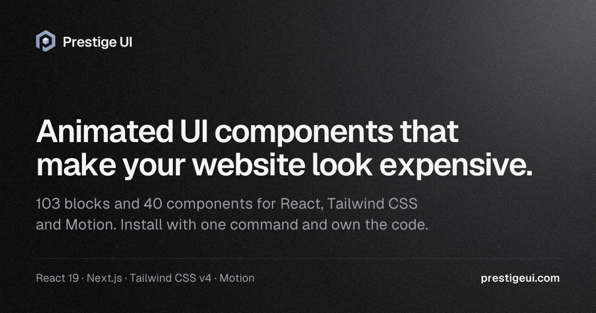

# Prestige UI

Animated React components and blocks built with Tailwind CSS and Motion. Install them with the shadcn CLI or copy the source from this repo.



[Website](https://prestigeui.com) · [Docs](https://prestigeui.com/docs/introduction) · [All components](https://prestigeui.com/components) · [All blocks](https://prestigeui.com/blocks)

This repo holds the free items (25 components and blocks). Live previews, props and examples for each one are on [prestigeui.com](https://prestigeui.com).

## Install

With the shadcn CLI, using the item's URL:

```bash
npx shadcn@latest add https://prestigeui.com/r/gradient-button.json
```

Or add the registry once to `components.json` and install by name:

```json
{
  "registries": {
    "@prestige": "https://prestigeui.com/r/{name}.json"
  }
}
```

```bash
npx shadcn@latest add @prestige/gradient-button
```

The CLI installs the dependencies, the shared `cn` helper and any CSS an item needs.

## Free components and blocks

| Item | Description |
| --- | --- |
| [shine-button](https://prestigeui.com/components/shine-button) | A CTA button with a sweeping shine highlight on hover. |
| [magnetic-button](https://prestigeui.com/components/magnetic-button) | A button that gently magnetizes toward the cursor. |
| [social-login-button](https://prestigeui.com/components/social-login-button) | Clean, accessible buttons for Google, Apple, and GitHub SSO. |
| [async-button](https://prestigeui.com/components/async-button) | A button with a smooth loading spinner and success state. |
| [copy-button](https://prestigeui.com/components/copy-button) | An interactive copy-to-clipboard button with micro-animations. |
| [gradient-button](https://prestigeui.com/components/gradient-button) | A glowing, animated gradient border button for primary CTAs. |
| [payment-button](https://prestigeui.com/components/payment-button) | Standardized Apple Pay and Google Pay buttons. |
| [interactive-button](https://prestigeui.com/components/interactive-button) | A button with advanced internal layout animations, like downloading. |
| [text-reveal](https://prestigeui.com/components/text-reveal) | Word-by-word blur reveal for headlines and copy. |
| [infinite-marquee](https://prestigeui.com/components/infinite-marquee) | Seamless looping marquee for logos, chips, and quotes. |
| [navbar-pill](https://prestigeui.com/components/navbar-pill) | A floating capsule with a sliding active pill. |
| [navbar-mega](https://prestigeui.com/components/navbar-mega) | A full-width header whose mega menus glide and resize between triggers. |
| [navbar-condense](https://prestigeui.com/components/navbar-condense) | A full-width header that tightens into a floating, frosted capsule as the page scrolls. |
| [navbar-announce](https://prestigeui.com/components/navbar-announce) | A navbar with a dismissible announcement bar that folds away smoothly and stays dismissed. |
| [footer-wordmark](https://prestigeui.com/blocks/footer-wordmark) | Link columns over an edge-to-edge wordmark that rises in and lights up under the pointer, with status, a live local clock and back-to-top. |
| [auth-otp](https://prestigeui.com/blocks/auth-otp) | Email then a 6-digit code: auto-advance, paste and autofill, a forgiving error with a gentle shake, and a resend countdown. |
| [scramble-text](https://prestigeui.com/components/scramble-text) | A text animation component that cycles characters through random glyphs before settling. |
| [marquee-rows](https://prestigeui.com/components/marquee-rows) | Three labelled rows of feature chips (security, workflow, insight) that travel at their own pace in alternating directions, and ease to a stop under the pointer. |
| [illustration-orbit](https://prestigeui.com/components/illustration-orbit) | Eight tool logos on a ring around an AI model. They connect in turn: a beam runs each spoke inward, the line stays inked, and the model answers every arrival with a single ripple. |
| [cta-bloom](https://prestigeui.com/blocks/cta-bloom) | A centered closing panel on a slow color field that drifts like light on paper and brightens under the pointer, with two actions and three short reassurances. |
| [command-palette](https://prestigeui.com/blocks/command-palette) | A ⌘K command palette for an app: a search button that opens a dialog of pages and actions in groups, with their own shortcuts. Typing ranks matches as you go and marks the matched letters, projects and help appear once you search, and the last items you chose come first under Recent. It works fully from the keyboard, Escape clears the search before it closes, and on phones it fills the width. |
| [settings-profile](https://prestigeui.com/blocks/settings-profile) | A profile settings page: photo upload by click or drop with honest size and type checks, name, and a username with a live availability check that suggests a free one when it's taken. Changing the email sends a confirmation link and keeps the old address active until it's confirmed, with a timed resend. Language, time zone (with each zone's current time), date format and week start show today's date as you'll see it. Edits stay a draft until the save bar's Save or ⌘S, and Discard puts everything back. |
| [dashboard-overview](https://prestigeui.com/blocks/dashboard-overview) | The home page of a business dashboard. Switch between metrics to change the main chart, compare with the previous period, click any point to see what made it up, and follow recent activity and goals. Includes loading, empty and error states, CSV export, and any locale or currency. |
| [background-ink](https://prestigeui.com/backgrounds/background-ink) | A watercolor simulation behind your content. Drops of ink land on paper, bloom and dry into darker rims; a click drops more ink and a pointer moving through wet ink drags it like a brush. |
| [model-picker](https://prestigeui.com/ai-blocks/model-picker) | A menu for choosing the AI model. Models are grouped by provider and searchable, and a side pane compares the one under the cursor: what it's good at, relative intelligence, speed and cost, context size and what it accepts. Models on a higher plan stay visible with an upgrade button. Works from the keyboard. |

## Manual install

1. Requires React 19 and Tailwind CSS v4.
2. Install the dependencies: `npm install clsx lucide-react motion tailwind-merge`
3. Copy `lib/utils.ts` and the files you need from `components/prestigeui/`. Files ending in `-ui.tsx` are shared parts used by their family (for example `auth-ui.tsx` for `auth-otp.tsx`), and `prestige-brand.tsx` is the placeholder logo used in the navbar, footer and auth blocks.
4. For Shine Button and Basic Marquee, add `styles/prestigeui.css` to your global CSS.

The imports use the `@/` alias, as in a standard shadcn/ui project.

## More

Pro blocks and templates (heroes, pricing, bento grids, AI blocks, backgrounds) are on [prestigeui.com](https://prestigeui.com/pricing).

## License

MIT. See [LICENSE](LICENSE).
